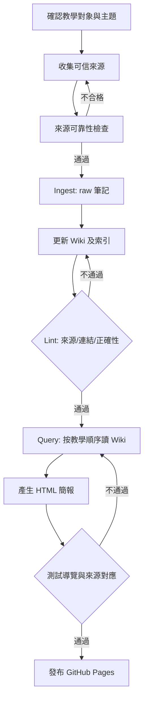

# Loop / Graph 流程與設計理由

## 迴圈說明
- **來源迴圈**：來源不可信或不明確時重新查找來源，不能先寫簡報再猜測出處。
- **Wiki 迴圈**：新資料可能修改多個概念頁，Lint 檢查後再回去修改索引及交叉連結。
- **簡報迴圈**：若出現錯誤、太艱深、來源不足或排版不佳，返回 Query 取得正確內容，再重新生成。

## 為何這樣設計
將原始資料保留為可追溯來源；把重複整理出的知識累積在 Wiki，而不是每次從頭摘要；透過前置來源檢查減少錯誤流向教學簡報。這是依照 Karpathy 的概念設計的**小型人工協助工作流程**，不是已建置自動化 LLM Agent 執行平台。
